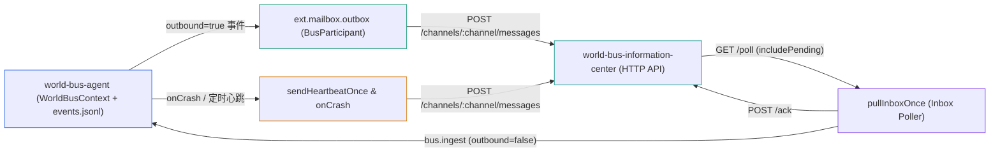
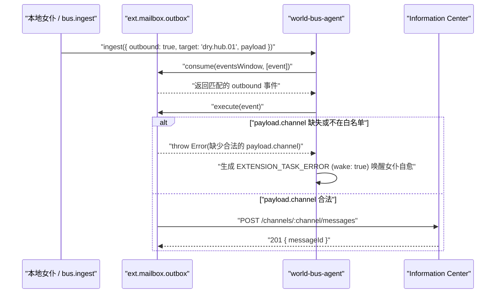

<!--
@file docs/architecture.md
@description World Bus Mailbox 架构设计文档
@date 2026-11-20
@version 0.1.0
-->

# World Bus Mailbox 架构设计文档

## 1. 架构定位与设计原则

`world-bus-mailbox` 是运行在每个 `world-bus-agent` 节点进程内的**纯客户端通信插件**, 遵循事件总线控制反转 (IoC) 原则:

- **服务端解耦**: 邮局路由, 消费组状态, PEL 与超时巡检已完全剥离至独立容器/进程 `world-bus-information-center`, 本包仅通过标准 `fetch` 协议与之通信, 无任何内置 HTTP 服务端或 `hono` 运行时依赖.
- **协议与测试友好**: 支持通过 `MailboxExtensionOptions.fetch` 注入 Hono `ic.app.request` 或故障模拟替身, 无需起真实网络端口即可完成全链路端到端验证.
- **先落盘后签收 (At-Least-Once + 本地幂等)**: 收信时必须先等待 `bus.ingest()` 将事件写入本地 `events.jsonl` 后才发送 `/ack`, 并在启动期与运行期维护 `ingestedMessageIds` 集合消除重复入账.

---

## 2. 系统交互与模块关系



---

## 3. 核心时序机制

### 3.1 Outbox 外发门禁与自愈闭环



### 3.2 Inbox PEL 断电恢复与幂等签收

```mermaid
sequenceDiagram
    participant Ledger as "本地 events.jsonl"
    participant Box as "attachMailboxExtension"
    participant Bus as "world-bus-agent"
    participant IC as "Information Center"

    Note over Ledger,Box: "节点启动初始化阶段"
    Box->>Ledger: "loadIngestedMessageIds(workspaceDir)"
    Ledger-->>Box: "预热已入账 _mailMeta.messageId 集合"
    Note over Box: "needPendingRecovery = true"

    Box->>IC: "GET /poll?...&includePending=true"
    IC-->>Box: "返回 PEL 未签收消息列表"
    loop "逐条处理 StoredMessage"
        alt "ingestedMessageIds 未包含 messageId"
            Box->>Bus: "bus.ingest({ ..., outbound: false, payload: { _mailMeta } })"
            Box->>Box: "ingestedMessageIds.add(messageId)"
        else "已存在于本地账本"
            Box->>Box: "跳过 bus.ingest 防止重复入账"
        end
        Box->>IC: "POST /ack { consumerGroup, channel, messageId }"
    end
    Box->>Box: "整批成功后置 needPendingRecovery = false"
```

---

## 4. 关键工程实现细节

1. **并发防重入锁 (`polling`)**: `pullInboxOnce()` 内部通过布尔标志 `polling` 防止定时轮询与手动触发并发执行导致同一条消息被重复拉取和重复入账, 并在 `finally` 中释放.
2. **非阻塞定时器 (`.unref()`)**: 后台轮询定时器与心跳定时器均调用 `timer.unref()`, 确保测试进程或宿主节点在优雅停机时不会被后台定时器挂起, 同时通过 `controller.stop()` 支持显式销毁.
3. **跨频道实时唤醒语义**: `pullInboxOnce()` 按 `subscribeChannels` 顺序对拉取到的新消息逐条调用 `await bus.ingest(localInput)`. 根据 `world-bus-agent` 运行时契约, 每条 `wake: true` 的入站事件会即时触发一次 `triggerMaidTurn`, 而 `wake: false` 事件 (如静默心跳) 会沉入 `stock` 等待后续唤醒或 `tick` 一并处理.
4. **崩溃旁路独立投递**: `bus.onCrash` 不经过本地账本与 `Outbox` 队列, 直接调用 `publishToInfoCenter("stream:order_events", ...)` 上报 `NODE_CRASH_ALERT`, 避免节点处于崩溃态 (`crashed = true`) 时被总线拦截.
